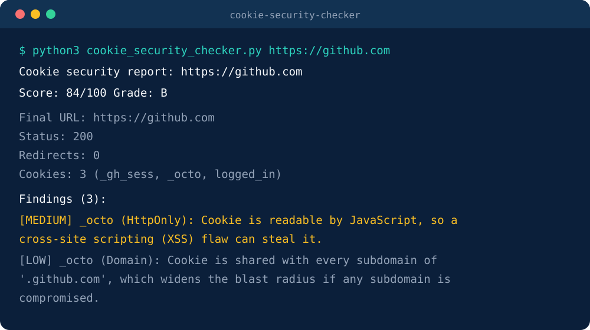
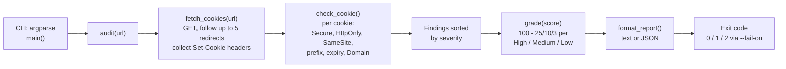

<p align="center">
  
</p>

<h1 align="center">Cookie Security Checker</h1>

<p align="center"><strong>Audit any site's cookies and grade their security in seconds.</strong></p>

<p align="center">
  <a href="LICENSE"></a>
  <a href="https://github.com/sajidhussainraza/cookie-security-checker/releases"></a>
  <a href="https://github.com/sajidhussainraza/cookie-security-checker/stargazers"></a>
  <a href="https://github.com/sajidhussainraza/cookie-security-checker/network/members"></a>
  <a href="https://github.com/sajidhussainraza/cookie-security-checker/issues"></a>
  <a href="https://github.com/sajidhussainraza/cookie-security-checker/commits/main"></a>
  <a href="https://github.com/sajidhussainraza/cookie-security-checker/actions/workflows/ci.yml"></a>
  <a href="https://github.com/sajidhussainraza/cookie-security-checker"></a>
  
  <a href="CONTRIBUTING.md"></a>
</p>

<p align="center">
  <a href="#demo">Demo</a> |
  <a href="#table-of-contents">Docs</a> |
  <a href="#installation">Install</a> |
  <a href="https://github.com/sajidhussainraza/cookie-security-checker/issues/new?template=bug_report.yml">Report Bug</a> |
  <a href="https://github.com/sajidhussainraza/cookie-security-checker/issues/new?template=feature_request.yml">Request Feature</a>
</p>

Cookie Security Checker audits any site's cookies for Secure, HttpOnly, SameSite, prefix, expiry and scope issues, then grades the site A to F with fixes.

## Why this exists

**Problem:** session cookies are often set without Secure, HttpOnly or SameSite, so one XSS flaw or one plain-HTTP request can hand an attacker a logged-in session.
**Solution:** this cookie security checker audits any website's cookies in one command and explains every gap in plain language, with the exact flag to fix.
**Result:** run it, fix the flags it lists, and watch the grade climb to A — then gate every deploy with `--fail-on high`.

## Demo



*Static preview of a real audit run against github.com (score 84/100, grade B). No animated GIF exists yet — see [docs/demo-capture.md](docs/demo-capture.md) for the exact script to record one.*

## Features

- 🔒 **Complete cookie security testing in one command** — Secure, HttpOnly, SameSite, `__Secure-` / `__Host-` prefix rules, expiry, and Domain/Path scope
- 🎯 **Session-aware severity** — session cookie security is judged harder: a missing flag on a `session`, `auth`, `token`, `sid`, `login`, `csrf` or `jwt` cookie is High severity, while the same gap on a preference cookie is Medium
- 📊 **A–F grade with a 0–100 score** — start at 100, lose 25 / 10 / 3 points per high / medium / low finding
- 🛠️ **A fix for every finding** — each issue ships with the exact flag or attribute to change, so a cookie flags audit becomes a to-do list
- 🤖 **CI-ready secure flag checker** — `--json` output and `--fail-on` exit codes turn it into a build gate
- 🕵️ **Redirect-aware website cookie audit** — follows redirects itself (up to 5 hops) and collects the `Set-Cookie` headers sent at every hop
- 🪶 **Zero dependencies** — standard library only (`http.client`, `ssl`, `urllib.parse`); no install step, no telemetry, nothing stored
- 🔍 **Read-only by design** — sends only anonymous GET requests; never logs in or submits data

## Table of contents

- [Quick start](#quick-start)
- [Installation](#installation)
- [Usage](#usage)
- [CLI reference](#cli-reference)
- [Configuration](#configuration)
- [Architecture](#architecture)
- [Project structure](#project-structure)
- [FAQ](#faq)
- [Roadmap](#roadmap)
- [Contributing](#contributing)
- [License](#license)
- [Acknowledgements](#acknowledgements)

## Quick start

Get a working result in under 60 seconds — no installation, no dependencies:

```bash
git clone https://github.com/sajidhussainraza/cookie-security-checker.git
cd cookie-security-checker
python3 cookie_security_checker.py https://example.com
```

You will see a report with a score out of 100, a letter grade, and one finding (with a fix) per cookie problem. For a site with real cookies, try `https://github.com` — see the [example](#example-a-real-audit-of-githubcom) below.

## Installation

### Prerequisites

| Requirement | Version | Notes |
| --- | --- | --- |
| Python | 3.8+ | Check with `python3 --version` |
| Git | any recent version | Only needed to clone the repo |
| pip packages | none | Standard library only — nothing to install |
| Network access | — | Needed to reach the site you audit |

### Windows

```powershell
git clone https://github.com/sajidhussainraza/cookie-security-checker.git
cd cookie-security-checker
py cookie_security_checker.py https://example.com
```

If `py` is not found, install Python from [python.org](https://www.python.org/downloads/) and tick **Add Python to PATH** during setup. (`python3` also works if it is on your PATH.)

### macOS

```bash
git clone https://github.com/sajidhussainraza/cookie-security-checker.git
cd cookie-security-checker
python3 cookie_security_checker.py https://example.com
```

If `python3` is missing, install it from [python.org](https://www.python.org/downloads/) or with Homebrew (`brew install python`).

### Linux

```bash
# Debian / Ubuntu — install Python and Git if they are missing
sudo apt install python3 git
git clone https://github.com/sajidhussainraza/cookie-security-checker.git
cd cookie-security-checker
python3 cookie_security_checker.py https://example.com
```

### Install from source

There is no package to install and no build step. Cloning the repository *is* the installation — the single file `cookie_security_checker.py` is the whole tool. (A PyPI package is on the [roadmap](#roadmap).)

### Verify the install

```bash
python3 cookie_security_checker.py --help
python3 tests/run_tests.py
```

`--help` prints the usage text and exits 0. The test suite runs 12 tests (11 offline, plus a live audit of github.com that is skipped automatically when the network is unreachable).

### Troubleshooting

| Error / symptom | Cause | Fix |
| --- | --- | --- |
| `python3: command not found` | Python is not installed or not on PATH | Install Python 3.8+; on Windows use `py` instead of `python3` |
| `Error: URL must start with http:// or https://` | The URL has no scheme | Include the scheme: `https://example.com`, not `example.com` |
| `Error: could not reach <url>` (exit code 2) | Network, DNS, or firewall problem, or the site blocks automated requests | Check your connection and try a known site such as `https://example.com` |
| No arguments given (usage error, exit code 2) | The URL argument is missing | Run `python3 cookie_security_checker.py --help` for usage |
| Score 100/100 but you expected findings | The site sets its cookies only after login or via JavaScript | The checker audits an anonymous visit only; logged-in or JS-set cookies need a browser session |
| Live test skipped when running the suite | The test machine has no network access | Nothing to fix — the 11 mock-server tests still run and cover the checks |

## Usage

### Basic: audit a site

```bash
python3 cookie_security_checker.py https://example.com
```

### Intermediate: machine-readable output

```bash
python3 cookie_security_checker.py https://example.com --json
```

The JSON report contains the URL, final URL, status, redirect count, cookie names, score, grade, and every finding with its severity, check, message, and fix.

### Advanced: fail a CI build on high-severity findings

```bash
python3 cookie_security_checker.py https://example.com --fail-on high
echo $?   # 0 = clean, 1 = high-severity findings, 2 = usage/network error
```

Fail on anything medium or worse:

```bash
python3 cookie_security_checker.py https://example.com --fail-on medium
```

### Example: a real audit of github.com

```console
$ python3 cookie_security_checker.py https://github.com
Cookie security report: https://github.com
Score: 84/100  Grade: B

  Final URL: https://github.com
  Status: 200
  Redirects: 0
  Cookies: 3 (_gh_sess, _octo, logged_in)

Findings (3):
  [MEDIUM] _octo (HttpOnly): Cookie is readable by JavaScript, so a
  cross-site scripting (XSS) flaw can steal it.
        Fix: Set the HttpOnly flag unless JavaScript genuinely needs
        to read this cookie.
  [LOW] _octo (Domain): Cookie is shared with every subdomain of
  '.github.com', which widens the blast radius if any subdomain is
  compromised.
        Fix: Drop the leading dot and the Domain attribute unless
        subdomains genuinely need the cookie.
  [LOW] logged_in (Domain): Cookie is shared with every subdomain of
  '.github.com', which widens the blast radius if any subdomain is
  compromised.
        Fix: Drop the leading dot and the Domain attribute unless
        subdomains genuinely need the cookie.
```

All three findings are deliberate choices by GitHub: `_octo` is a JavaScript-readable analytics cookie, and `.github.com` sharing is intentional so subdomains can read the login state. For a site that does not need either behaviour, all three would be real fixes. The full output of that run is saved in `examples/sample-output-github.com.txt` (captured 16 November 2026).

### Exit codes

| Code | Meaning |
| --- | --- |
| 0 | No findings at or above `--fail-on` |
| 1 | Findings at or above `--fail-on` were found |
| 2 | Usage error (bad URL, site unreachable) |

## CLI reference

| Argument | Type | Description |
| --- | --- | --- |
| `url` | positional, required | Website URL, e.g. `https://example.com` (must start with `http://` or `https://`) |
| `--json` | flag | Print the report as JSON instead of human-readable text |
| `--fail-on {high,medium,low}` | option, default `high` | Exit 1 when a finding at or above this severity is found |
| `-h`, `--help` | flag | Show the help message and exit |

### Python API

The checker can also be imported — `audit(url)` returns a report dictionary with `score`, `grade`, `cookies`, `cookie_names`, and a list of findings:

```python
from cookie_security_checker import audit

report = audit("https://example.com")
print(report["score"], report["grade"])
```

## Configuration

There is no configuration file and no environment variables. All behavior is controlled by the CLI flags above:

| Option | Type | Default | Description |
| --- | --- | --- | --- |
| `--json` | flag | off | Machine-readable JSON output |
| `--fail-on` | `high` / `medium` / `low` | `high` | Severity threshold for exit code 1 |

Fixed behavior (not configurable): up to 5 redirects followed, 15-second request timeout, Max-Age over 365 days flagged, `User-Agent: cookie-security-checker/1.0.0`.

## Architecture



## Project structure

```text
cookie-security-checker/
├── cookie_security_checker.py   # The whole tool: CLI, fetcher, checks, grading
├── README.md                    # This file
├── LICENSE                      # MIT license
├── CHANGELOG.md                 # Version history (Keep a Changelog + SemVer)
├── CONTRIBUTING.md              # How to contribute
├── CODE_OF_CONDUCT.md           # Contributor Covenant 2.1
├── SECURITY.md                  # How to report a vulnerability
├── .gitignore                   # Python / editor ignores
├── .editorconfig                # Indentation and line-ending rules
├── assets/
│   ├── banner.svg               # README banner (1280x640)
│   ├── banner.png               # PNG banner — upload via the GitHub website
│   ├── social-preview.png       # Social preview (1280x640) — upload via the GitHub website
│   ├── logo.svg                 # Square logo, readable at 64px
│   └── demo.svg                 # Static terminal preview of a real audit run
├── docs/
│   ├── brand-palette.md         # Palette, HEX codes, WCAG AA contrast checks
│   └── demo-capture.md          # How to record the real demo GIF
├── examples/
│   └── sample-output-github.com.txt  # Full output of the github.com audit (16 Nov 2026)
├── tests/
│   ├── run_tests.py             # Test runner: python3 tests/run_tests.py
│   └── test_cookie_security_checker.py  # 12 tests: unit + mock-server + live audit
└── .github/
    ├── ISSUE_TEMPLATE/
    │   ├── bug_report.yml       # Bug report form
    │   ├── feature_request.yml  # Feature request form
    │   └── config.yml           # Issue template config
    ├── PULL_REQUEST_TEMPLATE.md # PR checklist
    └── workflows/
        └── ci.yml               # Tests on Linux, Windows, macOS × Python 3.8–3.13
```

## Comparison with alternatives

Skipped: no competitors were specified for this project, so no comparison table is included rather than inventing one.

## FAQ

**Does the checker log in to the site?**
No. It sends only anonymous GET requests and never submits credentials or form data.

**Why did github.com score B (84/100)?**
GitHub deliberately leaves `_octo` readable by JavaScript (analytics) and shares `logged_in` across `.github.com` subdomains. Those are intentional choices, not oversights — for a site that does not need either behavior, they would be real fixes.

**Can I use it in CI?**
Yes. Run it with `--fail-on high` (or `medium`) and fail the build on exit code 1. Use `--json` if your pipeline parses the output.

**Why is a missing flag High severity on my session cookie but Medium on another cookie?**
Cookie names containing `session`, `auth`, `token`, `sid`, `login`, `csrf`, `jwt` and similar are treated as session-like and held to a stricter bar, because stealing one bypasses login entirely. The same gap on a plain preference cookie is Medium.

**Does it check cookies set after login or by JavaScript?**
No. It audits only the cookies a site sets on an anonymous visit. Cookies set after login or by JavaScript in the browser need a logged-in browser session.

**Does it store or send my data anywhere?**
No. There is no telemetry and nothing is stored. The only network traffic is the GET requests to the URL you audit.

**What Python versions and operating systems work?**
Python 3.8+ on Windows, macOS, and Linux. There are no third-party dependencies, and CI tests all three operating systems across Python 3.8–3.13.

**How is the score calculated?**
Start at 100 and deduct 25 points per High, 10 per Medium, and 3 per Low finding. Grades: 90+ A, 75+ B, 60+ C, 40+ D, below 40 F.

## Roadmap

- [ ] `--version` flag (the version is stored in the code but has no CLI flag yet)
- [ ] `--timeout` option for slow sites (currently fixed at 15 seconds)
- [ ] `--user-agent` option
- [ ] `--ignore-cookie` option for findings already accepted
- [ ] Audit multiple URLs in one run
- [ ] Colored terminal output
- [ ] PyPI package (`pip install cookie-security-checker`)
- [ ] Pre-commit hook example

## Contributing

See [CONTRIBUTING.md](CONTRIBUTING.md) for the full guide. Quick steps:

1. Fork the repository
2. Create a branch (`git checkout -b fix/my-fix`)
3. Add or update tests in `tests/` — new checks should come with a test
4. Run `python3 tests/run_tests.py` — all tests must pass
5. Open a pull request

Please keep the tool dependency-free (standard library only) and keep every finding paired with a plain-language fix. This project follows the [Contributor Covenant Code of Conduct](CODE_OF_CONDUCT.md). To report a security vulnerability privately, see [SECURITY.md](SECURITY.md).

## License

MIT — see [LICENSE](LICENSE) for details. Copyright (c) 2026 Sajid Hussain Raza.

## Acknowledgements

- Built with the Python standard library only — no third-party packages.
- Brand palette and contrast checks are documented in [docs/brand-palette.md](docs/brand-palette.md).
- The `__Secure-` and `__Host-` prefix rules follow the cookie prefix specification used by modern browsers.

[](https://star-history.com/#sajidhussainraza/cookie-security-checker&Date)

[](https://github.com/sajidhussainraza/cookie-security-checker/graphs/contributors)

---

**If this saved you time, please star the repo.** ⭐
